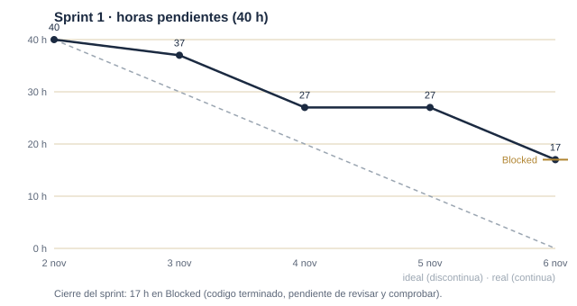
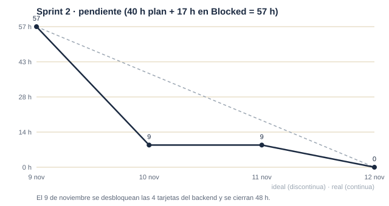

# Anexo II. Seguimiento y retrospectiva del desarrollo

**Proyecto:** RunnersZ · Reto 2 · cliente Hogwarts
**Entrega:** 12 de noviembre de 2026
**Equipo:** Alain (`@alain8123`) y Jairo (`@jairoben`)
**Periodo cubierto:** 26 de octubre – 12 de noviembre de 2026 (Discovery + Sprint 1 + Sprint 2)

---

## 1. Referencias

| Elemento | Enlace |
|---|---|
| Repositorio | <https://github.com/dm2-ethazi/Reto2-RunnersZ> (rama de integración `develop`) |
| Tablero GitHub Projects | <https://github.com/orgs/dm2-ethazi/projects/14/views/1> |
| Anexo I (línea base) | Integrado en el contrato técnico v2.0, secciones I.1–I.6: capacidad de 80 h-persona, 19 Issues con criterios de aceptación y horas, objetivos de los dos sprints, acuerdos de trabajo y 8 riesgos con su mitigación. Copia de trabajo en la memoria del equipo (`reto/contrato.md`). |

> **Nota de coherencia:** el Anexo I enlaza `projects/6`; el tablero en uso desde el 9 de noviembre es `projects/14`. Conviene corregir la referencia en el PDF final del contrato para que ambos anexos apunten al mismo tablero.

---

## 2. Resumen por sprint

### Flujo del tablero

El tablero siguió el flujo acordado en el Anexo I: **Backlog → En curso → Blocked → Hecho**. La distinción importante es la de `Blocked`: allí se quedaba una tarea **terminada en código pero pendiente de revisión y comprobación**. No contaba como hecha hasta que la revisaba el otro integrante y el pipeline estaba en verde. Por eso hay trabajo «hecho» que siguió pesando en el burndown y que solo se desbloqueó en la integración del 9 de noviembre.

### Sprint 1 · 2–6 de noviembre (40 h de capacidad)

| | Detalle |
|---|---|
| **Objetivo (Anexo I)** | Servidor desplegable con Docker (Vigenère, César y AES-GCM por bloques probados) y primeros flujos de Android y Unity. |
| **Previsto** | 9 Issues, 40 h: #1 repositorio y CI (3), #2 Docker + API con token (4), #3 Vigenère y César (3), #4 AES-GCM y formato `.enc` (6), #5 endpoints multipart (4), #6 Android esqueleto (5), #7 Android descifrar imagen (5), #8 Unity escena y física (6), #9 Unity frases y César (4). |
| **Terminado dentro del sprint** | 23 h: #1 (3), #6 (5), #7 (5), #8 (6), #9 (4). Evidencia: merge `944dda9` (3 nov, integra `i06-android-api` e `i07-android-image`), notas de Unity del 5 y 7 de noviembre y commits de `unity/` de esos días. |
| **Terminado, pero en `Blocked`** | 17 h: #2, #3, #4 y #5. El código estaba terminado dentro del sprint, pero las cuatro tarjetas quedaron en `Blocked` a la espera de revisión y comprobación, así que no se dieron por hechas ni pasaron a `Hecho`. Se desbloquearon el 9 de noviembre al revisarse y comprobarse entre los dos integrantes. No fue trabajo sin empezar: fue trabajo sin verificar. |
| **Cambios de alcance** | #1 ya estaba prácticamente hecho al empezar el sprint (base del monorepo el 26 de octubre); se descontó del trabajo real del sprint. El César del servidor se adelantó al Sprint 1 junto con Vigenère, como estaba previsto. |

### Sprint 2 · 9–12 de noviembre (40 h de capacidad + 17 h bloqueadas)

| | Detalle |
|---|---|
| **Objetivo (Anexo I)** | Completar JavaFX, César en Android y el juego; cobertura ≥ 80 % con pipeline en verde; pruebas del Anexo VI.4; APK y fat JAR; manuales y demo. |
| **Previsto** | 10 Issues nuevas, 40 h, más las 17 h que seguían en `Blocked`: 57 h sobre una capacidad de 40 h. |
| **Terminado** | Los 10 Issues nuevos y los 4 que venían de `Blocked` del Sprint 1. Evidencia: integración de los cuatro módulos en `develop` el 9 de noviembre, con el pipeline en verde. |
| **Arrastrado al cierre** | Ninguno como Issue; las 17 h bloqueadas entraron en `Hecho` el mismo 9 de noviembre tras la revisión. Dos Issues quedaron en estado **parcial**: #17 (APK de Android y de Unity) y #19 (pruebas en dispositivos). |
| **Cambios de alcance** | Tres decisiones tomadas durante el sprint, todas documentadas en el repositorio: 1. El fat JAR pasó de «uno por plataforma» a **un único JAR para Windows y Linux** (54 `.dll` + 10 `.so`), porque el pliego pide la misma aplicación y un solo artefacto simplifica la entrega. 2. Se retiraron del repositorio las carpetas `wiki/` y `docs/`: la documentación vive en cada `README` de módulo y en los anexos entregados en Moodle. 3. Se renombró `.github/README.md` a `.github/COLABORACION.md` porque GitHub anteponía ese fichero al `README.md` de la raíz, y la portada del repositorio debía ser el README general. |

**Esfuerzo estimado frente al real.** El Anexo I estimó 80 h-persona. Las horas reales no se registraron tarea a tarea —una debilidad que se explica en el apartado 6—, así que el indicador disponible es la actividad del repositorio: **179 commits entre el 26 de octubre y el 12 de noviembre**, con trabajo los días 26, 29, 30 y 31 de octubre (Discovery), 2, 3, 4, 5, 6, 7 y 8 de noviembre (Sprint 1 y cola del sprint) y 9 y 12 de noviembre (Sprint 2). El reparto por autor es 101 commits de Jairo y 81 de Alain.

---

## 3. Seguimiento verificable

### 3.1 Dailies

Las reuniones diarias de 5 minutos se registraron en la memoria del equipo (notas fechadas del vault) y su efecto se puede contrastar con los commits de cada jornada:

| Fecha | Commits | Contenido de la jornada | Notas de la daily |
|---|---:|---|---|
| 26 oct | 19 | Base del monorepo, backend inicial y cliente de escritorio | `2026-11-05-*` resume decisiones de arranque |
| 29 oct | 36 | API con token, Vigenère, César y esquema `.enc` | — |
| 30–31 oct | 13 | Errores `{code, message}`, pruebas iniciales | — |
| 2 nov | 20 | Integración de Android (API e imagen) en su rama | `2026-11-05-android-runnersz` |
| 3 nov | 6 | Cierre de `i06` e `i07` (merge `944dda9`) | — |
| 4 nov | 7 | Unity: escena y validación | `2026-11-05-emulador-runnersz` |
| 5 nov | 16 | Unity: enemigos y ritmo; Android: emulador | `2026-11-05-*`, `2026-11-06-ejecutar-emulador-android` |
| 6 nov | 22 | JavaFX: iconos, botones y accesibilidad | `2026-11-06-iconos-y-botones-runnersz-desktop` |
| 7 nov | 17 | Unity: vidas, teclado propio y audio; JavaFX: ayuda y atajos | `2026-11-07-*` |
| 8 nov | 3 | Fat JAR de escritorio; APK de Android en móvil físico | `2026-11-08-*` |
| 9 nov | 13 | Revisión y desbloqueo de las cuatro tarjetas del backend; integración de los cuatro módulos en `develop`; README general; cobertura | `2026-11-09-*` |
| 12 nov | 7 | Docker del backend, APK de Android y de Unity, CI y documentación | `2026-11-12-docker-backend*` |

### 3.2 Bloqueos relevantes y decisiones

| Día | Bloqueo | Impacto | Decisión y evidencia |
|---|---|---|---|
| 2 nov | El APK de Android no alcanzaba la API desde el móvil (red e IP) | Alto | Campo editable de dirección + botón «Probar» que llama a `/auth/check` (mitigación del riesgo previsto en I.6) |
| 6 nov | La accesibilidad de los diálogos se rompía al recortar los botones | Medio | Se corrigió el recorte y se añadieron atajos y ayuda contextual (nota `2026-11-07-ayuda-y-atajos`) |
| 6–9 nov | Cuatro tarjetas del backend en `Blocked`: hechas, pero sin revisar ni comprobar | Alto | Revisión conjunta el 9 de noviembre e integración de los cuatro módulos en `develop`; la cobertura pasa a ser puerta de CI para que «revisado» signifique algo verificable |
| 12 nov | `docker compose` devolvía 500 al cifrar: el `tmpfs` no tenía los permisos del usuario del contenedor | Alto | `uid`/`gid`/`mode` de `appuser` en el `tmpfs` y `.env` opcional; nota `2026-11-12-docker-backend-2` |
| 12 nov | El JAR «de Linux» salía con 54 `.dll` y 0 `.so`: los perfiles de OpenJFX no ven las propiedades del POM | Alto | Clasificadores explícitos y filtro del empaquetado; un único JAR con los nativos de los dos sistemas verificado (54 `.dll` + 10 `.so`, 0 entradas duplicadas) |
| 12 nov | Gradle 8.9 no arranca con el JDK 25 del equipo | Medio | Se compila con JDK 21 y `ANDROID_HOME` explícito; documentado en `android/README.md` |

### 3.3 Burndown

Datos de respaldo: horas de cada Issue del Anexo I y fecha en que la Issue quedó cerrada (último commit que la entrega). Las horas pendientes son la suma de las Issues aún abiertas al terminar cada jornada.

**Sprint 1 (40 h)**

| Día | Issues cerradas | Horas cerradas | Pendientes |
|---|---|---:|---:|
| Inicio (2 nov) | — | — | 40 |
| 2 nov | #1 | 3 | 37 |
| 3 nov | #6, #7 | 10 | 27 |
| 4 nov | — | 0 | 27 |
| 5 nov | #8, #9 | 10 | 17 |
| Cierre (6 nov) | — | 0 | **17** |

El sprint **no llegó a cero**: cerró con 17 h pendientes, todas del backend y todas **en `Blocked`**. El código estaba terminado, pero no se daba por hecho hasta revisarlo y comprobarlo; esa cola de revisión mantuvo la curva plana el 4 y el 6 de noviembre. No es un fallo de estimación (las 40 h se cumplieron), sino de flujo: el trabajo salía más rápido de lo que se revisaba. Es el principal aprendizaje del sprint y la razón de la mejora acordada en la retrospectiva.

**Sprint 2 (40 h planificadas + 17 h que seguían en `Blocked` = 57 h)**

| Día | Issues cerradas | Horas cerradas | Pendientes |
|---|---|---:|---:|
| Inicio (9 nov) | — | — | 57 |
| 9 nov | #2, #3, #4, #5 (desbloqueadas de `Blocked`), #10, #11, #12, #15, #16, #17, #18 | 48 | 9 |
| 10 nov | — | 0 | 9 |
| 11 nov | — | 0 | 9 |
| Cierre (12 nov) | #13, #14, #19 | 9 | **0** |

El Sprint 2 asumió un 42 % más de trabajo del planificado (57 h frente a 40 h) y aun así cerró a cero. La curva es escalonada: el 9 de noviembre se cierran 48 h en la integración y el 12 se remata el resto con Docker, los APK y la documentación.

---

## 4. Colaboración técnica

### 4.1 Ramas e integración

Cada módulo se desarrolló en su rama (`feature/unity-v2`, `feature/android`, `feature/api` y `feature/desktop`) y se integró en `develop` el 9 de noviembre, respetando el acuerdo del Anexo I de no integrar trabajo sin revisión previa del otro integrante. Cada integración llegó con el pipeline en verde: `backend.yml` ejecuta ruff, isort y pytest con cobertura mínima del 80 %; `desktop.yml` ejecuta `mvn verify` con Xvfb y publica el informe JaCoCo y el JAR.

### 4.2 Pair programming

El pliego pide cuatro sesiones con rotación de roles. El repositorio deja constancia del trabajo conjunto en las integraciones cruzadas, pero **no se registraron las sesiones con el detalle de quién ejercía de driver y quién de navigator**; esa parte del registro es la que hay que completar antes de subir el PDF:

| # | Fecha | Ámbito | Evidencia en el repositorio | Driver / Navigator |
|---|---|---|---|---|
| 1 | 26 oct | Base del monorepo y arranque del backend | commits `CHORE: Inicia la base del monorepo`, merge `9eb49a8` | _(completar)_ |
| 2 | 3 nov | Android: API e imagen contra el servidor | merge `944dda9` (`i06`, `i07`) | _(completar)_ |
| 3 | 9 nov | Integración de los cuatro módulos y CI | integración de `feature/unity-v2`, `feature/android`, `feature/api` y `feature/desktop` en `develop` el 9 nov | _(completar)_ |
| 4 | 12 nov | Docker del backend y empaquetado (JAR único + dos APK) | commits del 12 nov, `desktop/pom.xml`, build de Android y Unity | _(completar)_ |

---

## 5. Reviews y retrospectivas

### Review del Sprint 1 (6 de noviembre)

- **Demostrado:** API con token y Vigenère/César en Docker, cifrado por bloques con recuperación idéntica; Android descifrando imagen contra la API; Unity con enemigo, puerta, física y banco de frases.
- **Funcionó:** trabajar con un responsable por plataforma y ramas `feature/*` mantuvo `develop` estable.
- **No funcionó:** el backend se quedó en su rama hasta el final y cuatro Issues acabaron en `Blocked`. El objetivo del sprint («servidor desplegable») estaba cumplido en código, pero no se podía considerar hecho porque nadie lo había revisado todavía; la demo se hizo sobre la rama, no sobre `develop`.
- **Mejora acordada:** *una tarjeta solo pasa a `Hecho` cuando el otro integrante la ha revisado y el pipeline está en verde*, y la revisión se hace el mismo día o el siguiente, sin acumular tarjetas en `Blocked`; la cobertura pasa a ser una puerta del CI y no una comprobación manual.

**Evidencia de que la mejora se aplicó:** el 9 de noviembre se crean `.github/workflows/backend.yml` y `.github/workflows/desktop.yml` con umbral de cobertura bloqueante y `.pre-commit-config.yaml` con hooks de pre-commit y pre-push; el resultado es 62 pruebas con 97,7 % en el backend, 83 pruebas de escritorio con el umbral del 80 % superado, 19 pruebas de Android y 27 de Unity, todas en verde.

### Review del Sprint 2 (12 de noviembre)

- **Demostrado:** aplicación completa de extremo a extremo (API + escritorio + Android + Unity), APK de `com.runnersz.reto2.android` (2.0.0, `targetSdk 35`), APK de `com.runnersz.game` (`targetSdk 36`, `arm64-v8a`) y fat JAR único de 13,4 MiB con los nativos de Windows y Linux.
- **Funcionó:** la integración continua como puerta de calidad, el README por módulo como fuente única de comandos y el estado `Blocked` como freno real: impidió dar por buenas tareas que aún no se habían comprobado.
- **No funcionó:** el calendario y el ritmo de revisión. La carga del Sprint 2 (57 h en 40 h de capacidad) y el desbloqueo de las cuatro tarjetas del backend comprimieron la verificación en dispositivo, que quedó pendiente.
- **Retrospectiva:** la mejora del Sprint 1 sí se aplicó, pero el equipo volvió a concentrar los cierres en la jornada de integración (48 h el 9 de noviembre). La lección es que **terminar no es entregar**: una tarjeta en `Blocked` es trabajo hecho sin valor acreditado, y si se acumulan, el sprint termina con deuda de revisión. Para un próximo proyecto, la mejora sería **revisar a diario** y cerrar Issues con alcance parcial, para que el burndown refleje el avance real.

---

## 6. Comparación con el contrato inicial

| Planificado (Anexo I) | Real | Explicación |
|---|---|---|
| Capacidad 80 h-persona (40 + 40) | 57 h de carga en el Sprint 2 (40 planificadas + 17 que seguían en `Blocked`) | La estimación global era razonable, pero el reparto por sprint no: el backend (17 h) estaba terminado en el Sprint 1 y se dio por hecho en el 2, al revisarlo |
| 19 Issues con estimación | 19 Issues en `Hecho`; 2 con alcance parcial (#17 y #19) | El código y los artefactos están; falta la prueba en teléfono físico de los dos APK |
| Un fat JAR por plataforma | Un único JAR para Windows y Linux | Decisión de empaquetado del 12 de noviembre; reduce la entrega a un artefacto y elimina el riesgo de confundir el JAR de un sistema con el de otro |
| Documentación en `wiki/` y `docs/` | Documentación en los `README` de cada módulo y en los anexos de Moodle | Se eliminaron del repositorio para no duplicar la documentación entregada |
| Protección de ramas en `main` y `develop` | Protección por hooks locales; el repositorio público la aplica en remoto | Riesgo previsto en I.6 y mitigado como se acordó |
| Cobertura ≥ 80 % | 97,7 % en el backend y umbral del 80 % cumplido en escritorio | La puerta de CI se añadió el 9 de noviembre, antes de lo previsto |

**Qué haríamos distinto.** Estimar por franjas de integración y no por módulos, y **revisar el mismo día**: el cuello de botella no fue escribir código, sino desbloquear lo escrito. Reservar una hora fija al final de cada jornada para revisar, integrar y mover a `Hecho` lo que esté en verde. También registrar las horas reales por Issue en el tablero; sin ese dato, el informe solo puede comparar tareas terminadas, no esfuerzo.

---

## 7. Reflexión sobre las aportaciones

**Alain (`@alain8123`) — servidor, cliente JavaFX, CI y documentación técnica.**
Aportación: API completa (Vigenère, César, AES-GCM por bloques, formato `.enc`, errores `{code, message}`), cliente JavaFX con progreso real y accesibilidad, pipeline y hooks, y la documentación de servidor y escritorio.
Aprendizaje principal: los detalles de empaquetado deciden tanto como el código — un JAR que parecía correcto llevaba 54 `.dll` dentro cuando decía ser de Linux, y solo se detectó contando nativos; y una puerta de cobertura en CI evita discusiones sobre calidad al final.
Experiencia driver/navigator: driver en el backend y el escritorio; navigator en la revisión de Unity y Android, donde ayudó a fijar criterios de aceptación y a comprobar los APK.

**Jairo (`@jairoben`) — Android, minijuego Unity y arranque del repositorio.**
Aportación: CipherSprint (tres pestañas, César y AES, accesibilidad y APK firmado), minijuego completo (dificultad, rondas, vidas, pistas, paneles finales y soporte de pantalla) y la base del monorepo.
Aprendizaje principal: en Android y Unity el coste real está en la verificación en dispositivo —resolución, notch, teclado y densidad—, no en la compilación; y las opciones de build (IL2CPP, R8, `targetSdk`) hay que fijarlas antes de la primera entrega.
Experiencia driver/navigator: driver en Android y Unity; navigator en el servidor y el escritorio, donde revisó las rutas y comprobó el comportamiento del formato `.enc`.

---

## 8. Checklist del Hito 2

- [x] Software entregado: API, escritorio, Android y Unity en `develop`.
- [x] Historial de dailies (memoria del equipo) y commits diarios verificables.
- [x] Tareas cerradas con evidencia (commits y ramas asociadas); las que estuvieron en `Blocked` se desbloquearon con revisión, no por paso del tiempo.
- [x] Dos gráficos burndown con sus datos de respaldo.
- [x] Dos reviews y dos retrospectivas, con mejora acordada y aplicada.
- [x] Anexo II con comparación plan-realidad y aportación de cada integrante.
- [ ] Cuatro registros de pair programming con roles explícitos (tabla 4.2: falta rellenar driver/navigator).
- [ ] Prueba de los dos APK en un teléfono físico (limitación declarada en #17 y #19).

---

## 9. Nota sobre las fuentes

Este anexo se ha construido con tres fuentes verificables: el Anexo I del contrato técnico (capacidad, backlog, objetivos, acuerdos y riesgos), el historial real del repositorio (179 commits, ramas y fechas de integración, número de pruebas y cobertura) y las notas de sesión del equipo, que registran los bloqueos del 2, 6, 9 y 12 de noviembre.

Dos límites que conviene corregir antes de la entrega:

1. **Horas reales:** no se registraron por Issue. El informe compara tareas y fechas, no esfuerzo; si el profesorado pide horas reales, hay que añadirlas al tablero y recalcular la tabla del apartado 6.
2. **Tablero:** el historial de transiciones no se ha exportado (el Project 14 requiere autenticación), así que las fechas de cierre se han reconstruido con el último commit de cada Issue, y el paso por `Blocked` se ha deducido de la integración del 9 de noviembre. Son trazables, pero no sustituyen a la exportación del tablero.
