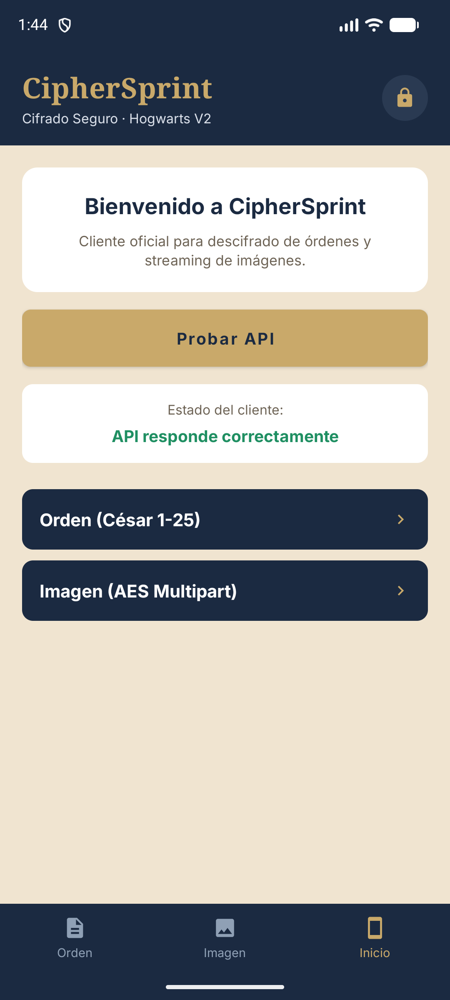

# 04 · Instalación de la app Android

**CipherSprint** es la app nativa Kotlin del Reto 2: tres pestañas (Inicio, Orden, Imagen) que delegan todas las operaciones en la API por HTTPS. No cifra nada en el dispositivo.

---

## Antes de empezar

- JDK **21** ([01 · Requisitos](01-Requisitos.md#4-escritorio-y-android-jdk-21)).
- Android SDK **35** y `adb` ([01 · Requisitos](01-Requisitos.md#5-android-sdk-35-y-adb)).
- Un móvil con depuración USB o un emulador.

Datos técnicos de la app:

| Dato | Valor |
|---|---|
| Paquete (`applicationId`) | `com.runnersz.reto2.android` |
| `minSdk` / `targetSdk` / `compileSdk` | 26 / 35 / 35 |
| Versión | `versionName 2.0.0`, `versionCode 2` |
| Gradle | 8.9 (wrapper incluido, no hay que instalarlo) |
| Servidor | `https://runnersz-api.onrender.com` (fijo en el código) |
| Autenticación | Token Bearer incrustado y ofuscado; **no se configura desde la app** |
| Límite de subida | 100 MiB |

> **Importante:** la app **no tiene pantalla de Ajustes**. La URL y el token están fijados en el código para que el token no pueda enviarse a otro host. Si quieres usarla con **tu** servidor, mira [12 · Personalizar el backend y el token](12-Personalizar-backend-y-token.md).

---

## Paso 1 — Apuntar al SDK de Android

Crea `android/local.properties` (archivo local, está en `.gitignore`):

```properties
sdk.dir=C\:\\Users\\<TU_USUARIO>\\AppData\\Local\\Android\\Sdk
```

O define la variable de entorno:

```powershell
$env:ANDROID_HOME = "C:\Users\<TU_USUARIO>\AppData\Local\Android\Sdk"
```

Si usas Android Studio, basta con abrir la carpeta `android/` una vez: el IDE genera el archivo.

---

## Paso 2 — Compilar y ejecutar las pruebas

Windows:

```powershell
cd <ruta-del-repositorio>\android
.\gradlew.bat testDebugUnitTest assembleDebug
```

Linux / macOS:

```bash
cd <ruta-del-repositorio>/android
./gradlew testDebugUnitTest assembleDebug
```

Qué hace:

- `testDebugUnitTest` ejecuta **19 pruebas** en **6 suites** (JUnit 4 + Robolectric + MockWebServer), todas contra un servidor HTTP simulado: cliente OkHttp, validaciones de César, validador de archivos, decodificación de imágenes y reconstrucción del token.
- `assembleDebug` genera un APK de depuración.

✅ Debes ver `BUILD SUCCESSFUL` y el informe en `android/app/build/reports/tests/testDebugUnitTest/index.html`.

Si Gradle protesta por la versión de Java (`Unsupported class file major version`), estás usando JDK 25: apunta `JAVA_HOME` a un JDK 21.

---

## Paso 3 — Elegir qué APK generar

### APK de depuración (rápido, para probar)

```powershell
.\gradlew.bat assembleDebug
```

- Salida: `android/app/build/outputs/apk/debug/app-debug.apk`
- Sin R8, más grande, mismo comportamiento.

### APK de entrega (`release`)

```powershell
.\gradlew.bat assembleRelease
```

- Salida: `android/app/build/outputs/apk/release/app-release.apk`
- Activa **R8 full mode** (`minifyEnabled`, `shrinkResources`, reempaquetado de clases y eliminación de llamadas a `Log`).
- Se firma con la **clave debug** para que sea instalable en la demo. Antes de publicar en una tienda hay que crear un keystore de producción y custodiarlo fuera del repositorio.

Copia el APK con un nombre claro si lo vas a entregar:

```powershell
Copy-Item app\build\outputs\apk\release\app-release.apk "$HOME\Desktop\CipherSprint.apk"
```

> El SHA-256 y el tamaño de la copia de entrega del equipo están en `android/README.md`. Un APK recompilado por ti tendrá otra huella: es normal.

---

## Paso 4 — Instalar en el móvil

1. Activa **Depuración USB** en el móvil (7 toques en *Número de compilación*).
2. Conéctalo y acepta el aviso de huella RSA.
3. Comprueba la conexión:

```powershell
adb devices
```

✅ Debe aparecer tu dispositivo con estado `device`.

4. Instala:

```powershell
adb install -r app\build\outputs\apk\release\app-release.apk
```

✅ `Success`.

Si sale `INSTALL_FAILED_UPDATE_INCOMPATIBLE`, desinstala la versión anterior (firma distinta):

```powershell
adb uninstall com.runnersz.reto2.android
adb install -r app\build\outputs\apk\release\app-release.apk
```

También puedes copiar el APK al teléfono y abrirlo desde el explorador de archivos (permitiendo "instalar apps desconocidas" para esa app).

### En un emulador

Crea un AVD con API 35 en Android Studio (*Device Manager → Create device*, por ejemplo Pixel 8a), arráncalo y repite `adb install`. El emulador ya viene con depuración activada.

---

## Paso 5 — Primera comprobación

1. Abre **CipherSprint** desde el cajón de apps (verás un splash breve).
2. En **Inicio**, la comprobación de la API se lanza automáticamente.
3. Si todo va bien, el estado indica conexión correcta; si falla, usa **Probar API** para reintentar.

✅ La comprobación llama a `GET /api/v1/auth/check` y espera `204`.

> Si la API pública está "dormida", la primera llamada puede tardar **hasta 50 segundos** (los servicios gratuitos de Render se suspenden sin tráfico). No es un fallo de la app.



Así se ve **Inicio** cuando la comprobación es correcta. El resto de pantallas están en [08 · Uso de Android](08-Uso-android.md#9-capturas-de-la-app).

---

## Cómo está organizada

```text
android/app/src/main/java/com/runnersz/reto2/android/
  MainActivity.kt      navegación, insets e intents (ACTION_SEND / ACTION_VIEW)
  SplashActivity.kt    splash de arranque
  data/                ApiClient (OkHttp), ApiConfig, ApiResult
  domain/              validaciones César, errores, decodificación de imagen
  security/            reconstrucción del token por fragmentos (XOR)
  ui/                  Inicio, Orden e Imagen (fragmentos + ViewModel)
android/app/src/main/res/   layouts, navegación, colores, textos, fuentes
android/app/src/test/       6 suites, 19 pruebas
android/gradle/wrapper/     Gradle 8.9
```

Notas de seguridad que conviene entender antes de modificar la app:

- El token **no aparece como literal**: se reconstruye en memoria desde tres fragmentos enmascarados (`CredentialA/B/C`) y solo se usa para la cabecera `Authorization`.
- No se guarda en preferencias, ni en backups, ni se muestra en la interfaz o en logs (`allowBackup=false`, reglas de extracción que excluyen preferencias, archivos y bases de datos).
- El tráfico es **solo HTTPS**: `usesCleartextTraffic=false` y `network_security_config.xml` con anclas del sistema. Por eso la app **no puede** hablar con un servidor HTTP local en la red (la demo del escritorio sí, porque permite `http://`).
- **No hay certificate pinning**: un dispositivo con una CA de usuario instalada podría interceptar el tráfico. Es una limitación declarada.

---

## Problemas típicos

| Síntoma | Solución |
|---|---|
| `SDK location not found` | Falta `local.properties` o `ANDROID_HOME` |
| `failed to find target with hash string 'android-35'` | Instala *SDK Platform 35* |
| `Unsupported class file major version 69` | JDK 25: usa JDK 21 |
| `adb: no devices/emulators found` | Activa depuración USB, acepta la huella RSA o arranca el emulador |
| `unauthorized` en `adb devices` | Acepta el aviso en el móvil |
| `INSTALL_FAILED_UPDATE_INCOMPATIBLE` | Desinstala la versión previa y reinstala |
| La comprobación de API falla | API dormida, sin internet o token desactualizado tras cambiar el servidor |

Lista completa: [11 · Problemas frecuentes](11-Problemas-frecuentes.md).

---

## Siguiente paso

- Usar la app: [08 · Uso de Android](08-Uso-android.md)
- Cambiar URL y token: [12 · Personalizar el backend y el token](12-Personalizar-backend-y-token.md)
- Instalar el minijuego: [05 · Instalación de Unity](05-Instalacion-unity.md)

[Volver al índice](Home.md)
