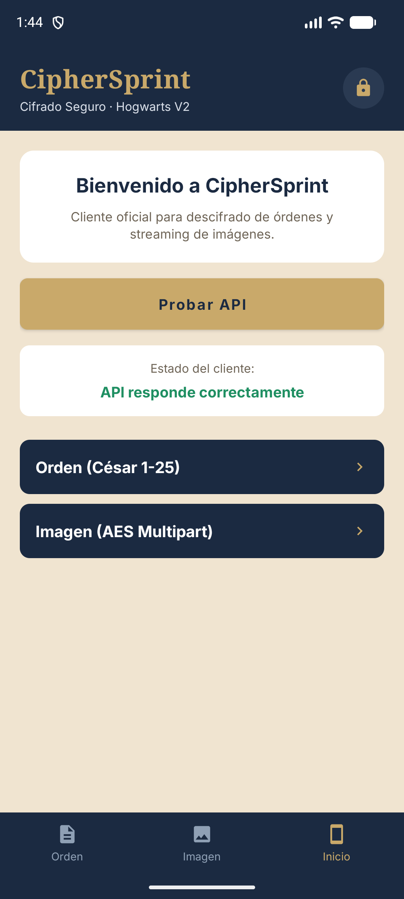
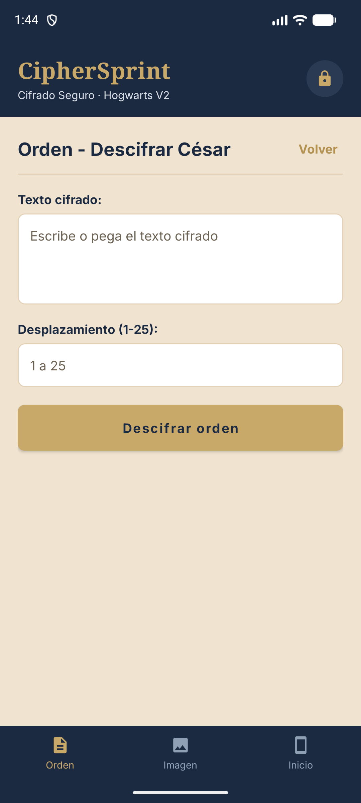
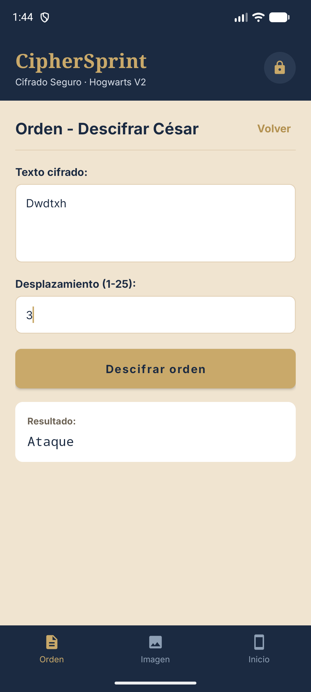
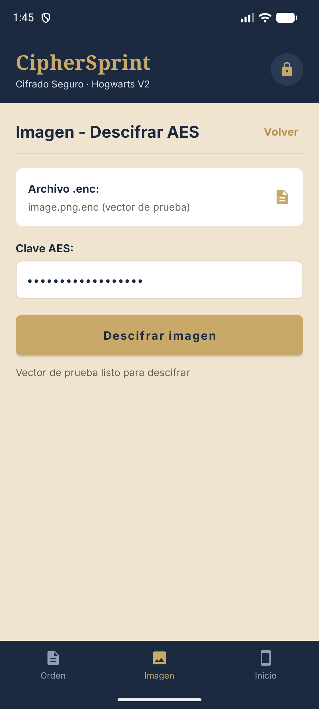
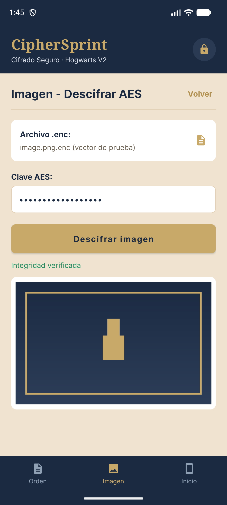
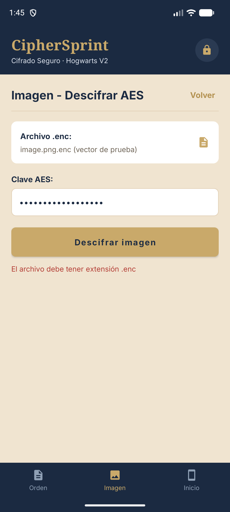
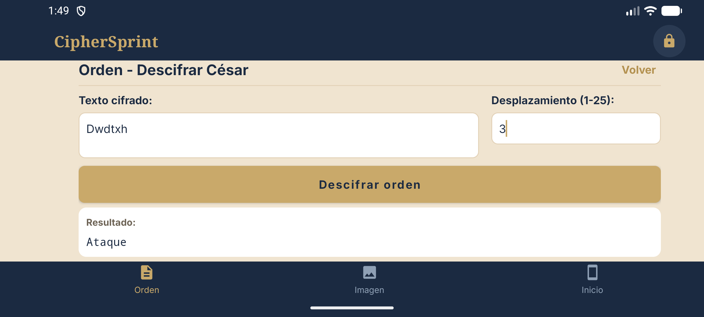
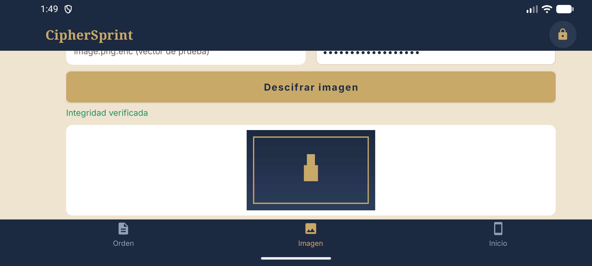

# 08 · Uso de la app Android (CipherSprint)

La app tiene tres pestañas y **no necesita configuración**: la URL del servidor y el token van dentro del APK.

---

## 1. Abrir la app

1. Toca el icono **CipherSprint**.
2. Aparece un splash breve y entra en **Inicio**.
3. La comprobación de la API se lanza **automáticamente**.

✅ Si la conexión es correcta, Inicio muestra el estado conectado. Si falla, pulsa **Probar API** para reintentar.

> El servicio público puede tardar hasta **50 s** en despertar si lleva tiempo sin tráfico. Espera antes de concluir que hay un error.

---

## 2. Navegación

- Barra inferior: **Orden · Imagen · Inicio**.
- Desde **Inicio** hay filas de acceso rápido a Orden e Imagen.
- Cada pestaña **conserva su formulario y su resultado** al cambiar de pestaña, al volver a tocar la pestaña activa y al girar el dispositivo.
- La app acepta archivos de otras aplicaciones mediante **Abrir con** o **Compartir** (`ACTION_SEND` / `ACTION_VIEW`) para texto, imagen u `octet-stream`.

---

## 3. Pestaña «Inicio»

| Elemento | Para qué |
|---|---|
| Bienvenida | Contexto del Reto 2 |
| **Probar API** | Llama a `GET /api/v1/auth/check` (espera 204) |
| Estado de conexión | Conectado / error con mensaje |
| Accesos a Orden e Imagen | Atajos a las otras pestañas |

Es la pantalla para diagnosticar: si aquí falla, ni Orden ni Imagen van a funcionar.

---

## 4. Pestaña «Orden» (César)

Descifra un mensaje cifrado con César. **El descifrado lo hace el servidor** (`POST /api/v1/text/caesar`).

### Con texto escrito

1. Escribe o pega el texto cifrado en el campo.
2. Indica el **desplazamiento** (entero de 1 a 25).
3. Pulsa **Descifrar**.
4. Toca el resultado para **copiarlo al portapapeles**.

### Con un archivo

1. Abre un `.txt` **UTF-8** de hasta 1 MiB desde otra app con **Abrir con → CipherSprint**, o compártelo.
2. El texto se carga en el campo.
3. Indica el desplazamiento y descifra.

Reglas y errores:

- Desplazamiento fuera de 1..25 → se avisa antes de llamar a la API.
- Texto vacío → no se envía.
- Error del servidor (`INVALID_SHIFT`, `UNAUTHORIZED`, red caída) → mensaje claro y **la app sigue abierta** para corregir y reintentar.

---

## 5. Pestaña «Imagen» (AES)

Descifra un fichero `.enc` que contenga una imagen. La pestaña arranca **sin archivo y sin clave**: tú eliges ambos.

1. **Selecciona el archivo** `.enc` (los que no acaban en `.enc` se rechazan antes de subirlos).
2. Escribe la **clave AES** (la misma que se usó al cifrar).
3. Pulsa **Descifrar**.
4. Si todo va bien, se muestra la **vista previa** de la imagen.

Comprobaciones que hace la app:

- Exige `X-Integrity: verified`; si falta, no muestra la imagen y avisa de que el servidor no confirmó la integridad.
- Si el resultado no decodifica como imagen, muestra «El archivo descifrado no es una imagen válida» (distinto de clave incorrecta).
- Límite: **100 MiB**. La imagen se decodifica **fuera del hilo de UI** y se reduce a 2048 px para no agotar memoria.

✅ Al terminar aparece la imagen y el mensaje de integridad verificada.

---

## 6. Qué espera el servidor (y por qué importa)

| Petición | Cabecera/validación |
|---|---|
| `GET /auth/check` | `Authorization: Bearer …` → 204 |
| `POST /text/caesar` | JSON `{text, shift, mode:"decrypt"}` → `result` |
| `POST /files/decrypt` | multipart `file` + `password` → bytes + `X-Integrity: verified` |

Todas las llamadas usan OkHttp con **timeout de 120 s**, sin reintentos automáticos (reintenta el usuario). El token se reconstruye en memoria en cada petición y solo vive en la cabecera.

---

## 7. Seguridad que debes conocer

- La dirección del servidor **no se puede cambiar desde la app**: así el token no puede enviarse a otro host.
- Solo HTTPS: `usesCleartextTraffic=false` y anclas de confianza del sistema. **No** puede hablar con un servidor HTTP de la red local sin recompilarla.
- `allowBackup=false` y extracción de datos restringida: no se copian preferencias, archivos ni bases de datos.
- No se muestra el token en ninguna pantalla, no se guarda en preferencias y no se escribe en logs.
- **No hay certificate pinning**: un dispositivo con una CA de usuario instalada podría interceptar el tráfico. Limitación declarada.
- Un token dentro de un APK **siempre es extraíble** con suficiente esfuerzo. Rótalo si distribuyes el APK: [12](12-Personalizar-backend-y-token.md).

---

## 8. Problemas típicos

| Síntoma | Causa probable | Solución |
|---|---|---|
| Estado «sin conexión» en Inicio | API dormida, sin internet o token desactualizado | Espera y pulsa **Probar API** |
| «Token no válido» | El servidor cambió de token | Recompila la app con el token nuevo |
| «El archivo supera el límite» | Más de 100 MiB | Usa un fichero menor |
| «El servidor no confirmó la integridad» | Servidor distinto al del proyecto | Usa la API del repositorio |
| «clave incorrecta o fichero dañado» | Clave AES distinta o `.enc` alterado | Usa la clave original |
| No aparece en «Abrir con» | Tipo de archivo no soportado | Texto (`text/plain`), imagen u `octet-stream` |

Más casos: [11 · Problemas frecuentes](11-Problemas-frecuentes.md).

---

## 9. Capturas de la app

Tomadas en el emulador con la API respondiendo. Sirven de referencia visual de cada estado descrito arriba.

| Inicio | Orden vacía |
|---|---|
|  |  |
| Estado del cliente: «API responde correctamente» | Marcadores de posición de texto y desplazamiento |

| Orden con resultado | Imagen preparada |
|---|---|
|  |  |
| `Dwdtxh` + 3 → `Ataque` | `.enc` elegido y clave escrita: «Vector de prueba listo para descifrar» |

| Imagen descifrada | Extensión no válida |
|---|---|
|  |  |
| «Integridad verificada» y vista previa | Rechazo antes de subir un archivo que no es `.enc` |

### En horizontal

| Orden | Imagen |
|---|---|
|  |  |
| Los campos pasan a dos columnas | La cabecera se compacta y la imagen ocupa el ancho |

---

## Siguiente paso

- Minijuego Unity: [09 · Uso de Unity](09-Uso-unity.md)
- Demo completa: [10 · Verificación y demo](10-Verificacion-y-demo.md)

[Volver al índice](Home.md)
