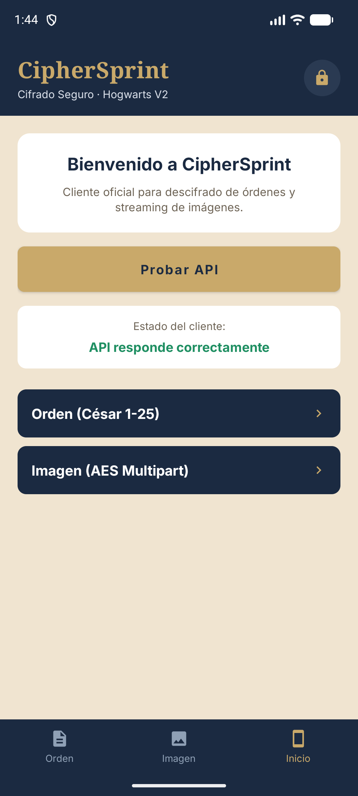
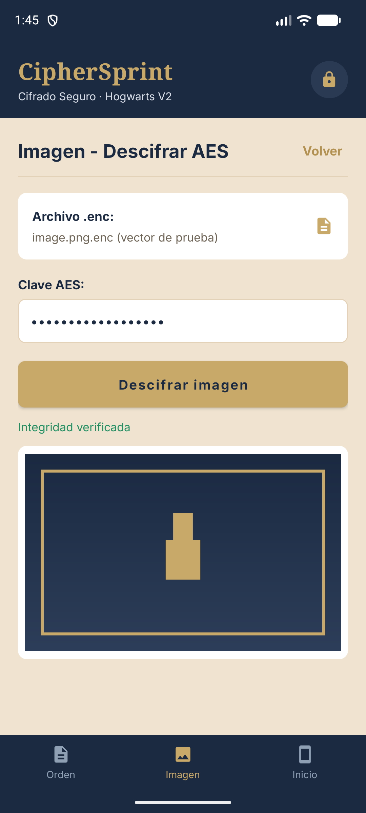

# RunnersZ · Wiki del proyecto

Bienvenido a la wiki de **RunnersZ**, el proyecto del **Reto 2** para el cliente **Hogwarts** (entrega: 12 de noviembre de 2026).

Aquí está todo lo necesario para **instalar, arrancar y usar cada apartado** del repositorio siguiendo pasos concretos, con el resultado que debes ver en cada uno. Si sigues las páginas en orden, puedes replicar el proyecto completo en otro ordenador.

> Esta wiki vive en la carpeta `wiki/` del repositorio, con sus capturas en `wiki/img/`. Si quieres publicarla en la pestaña *Wiki* de GitHub, sigue [README.md](README.md) (instrucciones al final de la carpeta).

---

## 1. Qué compone el proyecto

La arquitectura del contrato técnico v2.0 separa la criptografía en el servidor y deja a los clientes solo la interfaz:

| Apartado | Carpeta | Tecnología | ¿Usa la API? | Qué hace |
|---|---|---|---|---|
| Servidor / API | `backend/` | Python 3.12 + FastAPI + Docker | — | Cifra y descifra: Vigenère, César y AES-256-GCM por bloques de 1 MiB |
| Cliente de escritorio | `desktop/` | Java 21 + JavaFX | Sí, por HTTP | Cifra y descifra ficheros, y pestañas de Vigenère y César |
| App Android | `android/` | Kotlin + Gradle | Sí, por HTTPS | Descifra un `.enc` de imagen y resuelve órdenes César |
| Minijuego | `unity/` | Unity 6.3 (6000.3.24f1) | No | Juego autónomo de descifrado César para Windows y Android |
| Herramientas | `scripts/`, `.github/`, `.pre-commit-config.yaml` | Python, Git, GitHub Actions | No | Tablero, comprobadores de rama y de mensaje, hooks y CI |

La regla de oro del proyecto: **los clientes no implementan criptografía**. Todo el cifrado ocurre en el servidor y viaja por HTTP/HTTPS con un token Bearer.

| App Android · Inicio | App Android · Imagen descifrada |
|---|---|
|  |  |
| La API responde correctamente | «Integridad verificada» y vista previa |

Más capturas de cada pantalla: [08 · Uso de Android](08-Uso-android.md#9-capturas-de-la-app).

---

## 2. Ruta recomendada (primer día)

Sigue este orden. Cada paso enlaza a su página con los comandos exactos.

| # | Paso | Página | Tiempo orientativo |
|---|---|---|---|
| 1 | Instalar las herramientas comunes y comprobar versiones | [01 · Requisitos](01-Requisitos.md) | 20–60 min (descargas) |
| 2 | Levantar el servidor y comprobar la API | [02 · Instalación del servidor](02-Instalacion-servidor.md) | 10 min |
| 3 | Compilar y abrir el cliente de escritorio | [03 · Instalación del escritorio](03-Instalacion-escritorio.md) | 10–15 min |
| 4 | Compilar e instalar la app Android | [04 · Instalación de Android](04-Instalacion-android.md) | 20–30 min |
| 5 | Abrir el minijuego Unity y generar los ejecutables | [05 · Instalación de Unity](05-Instalacion-unity.md) | 15–30 min |
| 6 | Recorrer la demo de extremo a extremo | [10 · Verificación y demo](10-Verificacion-y-demo.md) | 15 min |

**Si solo quieres ver algo funcionando ya:** el servidor público de la demo responde en `https://runnersz-api.onrender.com/api/v1/health`, y la app Android ya apunta a él. Puedes saltar al [uso de Android](08-Uso-android.md) e instalar el APK compilado.

**¿Trabajas en Linux?** Los mismos pasos, con los comandos de Ubuntu/Debian (JDK 21, uv, Docker, SDK de Android y Unity), están en [14 · Ejecutar todo en Linux](14-Linux.md).

---

## 3. Índice completo

### Instalación

- [01 · Requisitos y comprobación del entorno](01-Requisitos.md)
- [02 · Instalación del servidor (API)](02-Instalacion-servidor.md)
- [03 · Instalación del cliente de escritorio](03-Instalacion-escritorio.md)
- [04 · Instalación de la app Android](04-Instalacion-android.md)
- [05 · Instalación del minijuego Unity](05-Instalacion-unity.md)
- [14 · Ejecutar todo en Linux](14-Linux.md) — comandos para cada apartado en Ubuntu/Debian

### Uso

- [06 · Uso de la API (servidor)](06-Uso-servidor.md)
- [07 · Uso del cliente de escritorio](07-Uso-escritorio.md)
- [08 · Uso de la app Android](08-Uso-android.md)
- [09 · Uso del minijuego Unity](09-Uso-unity.md)

### Verificación, soporte y mantenimiento

- [10 · Verificación y guion de la demo](10-Verificacion-y-demo.md)
- [11 · Problemas frecuentes](11-Problemas-frecuentes.md)
- [12 · Personalizar el servidor y el token de la app](12-Personalizar-backend-y-token.md)
- [13 · Flujo de trabajo, hooks y CI](13-Flujo-de-trabajo-y-CI.md)

### Documentación original del repositorio

La wiki resume y ordena estos manuales; si algo no aparece aquí, la fuente es:

- `README.md` (raíz) — visión general, estructura y estado.
- `backend/README.md` — API, rutas, errores y formato `.enc`.
- `desktop/README.md` — cliente JavaFX, accesibilidad y pruebas.
- `android/README.md` — CipherSprint, seguridad y validación.
- `unity/README.md` — juego, compilaciones y validaciones.
- `scripts/README.md` y `.github/README.md` — herramientas y colaboración.

---

## 4. Estado comprobado

Datos verificados al escribir esta wiki (12 de noviembre de 2026):

| Elemento | Estado |
|---|---|
| API pública de la demo | `GET https://runnersz-api.onrender.com/api/v1/health` → `200 {"status":"ok","version":"2.0.0"}` |
| Backend en local | `uv sync --locked` y `uv run pytest` → **62 pruebas, 0 fallos, 97,71 % de cobertura** |
| Cliente de escritorio | Cobertura medida **82,0 %** (936 de 1142 líneas); 64 pruebas JUnit 5 |
| App Android | `versionName 2.0.0`, `minSdk 26`, `targetSdk 35`; 19 pruebas en 6 suites |
| Minijuego Unity | Unity **6000.3.24f1**; 25 pruebas EditMode y 2 PlayMode; APK arm64 generado |
| Ejemplos de la API | Verificados: César y Vigenère devuelven exactamente lo que muestra la página 06 |

> Los ejecutables (`unity/Builds/`, `desktop/target/`, APK) **no se versionan** en Git: se regeneran con las instrucciones de esta wiki. Ver [05](05-Instalacion-unity.md) y [03](03-Instalacion-escritorio.md).

---

## 5. Convenciones de esta wiki

- Los comandos están en **PowerShell**; para Linux, usa los equivalentes de [14 · Ejecutar todo en Linux](14-Linux.md).
- Sustituye lo que va entre `<>`: `<TU_TOKEN>`, `<IP_DEL_PC>`, `<ruta-del-repositorio>`.
- Cada paso termina con una **comprobación** (✅) que dice qué debes ver. Si no lo ves, ve a [Problemas frecuentes](11-Problemas-frecuentes.md) antes de continuar.
- Los enlaces a otras páginas son archivos `.md` relativos, así que funcionan igual en GitHub, en VS Code y en Obsidian.

---

## 6. Seguridad: lo que nunca se publica

- El **token de la API** (`RZ_API_TOKEN`) vive solo en `backend/.env`, que está en `.gitignore`. En el repositorio únicamente está `.env.example` con valores ficticios.
- Las **contraseñas de los ficheros** no se guardan en ningún sitio: ni en el cliente, ni en el servidor, ni en los logs.
- El **token de Android** va ofuscado dentro del APK. Eso eleva el coste de extraerlo, pero **no lo hace imposible**: si el APK se distribuye, considera el token comprometido y rótalo. Cómo hacerlo, en [12](12-Personalizar-backend-y-token.md).
- HTTP transmite token y contraseña sin cifrar. El contrato lo limita a una **red local controlada** para la demo (§3.4); fuera de ahí, usa HTTPS.
